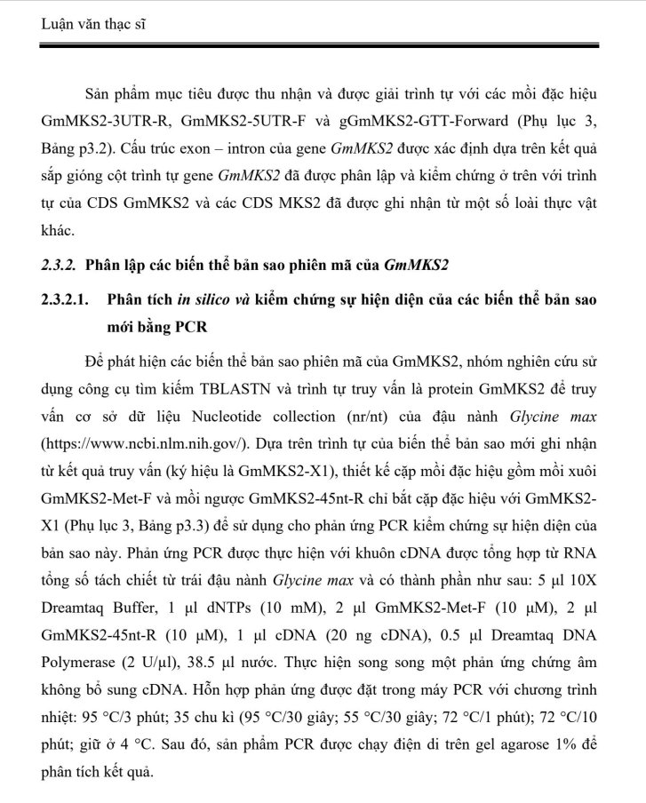
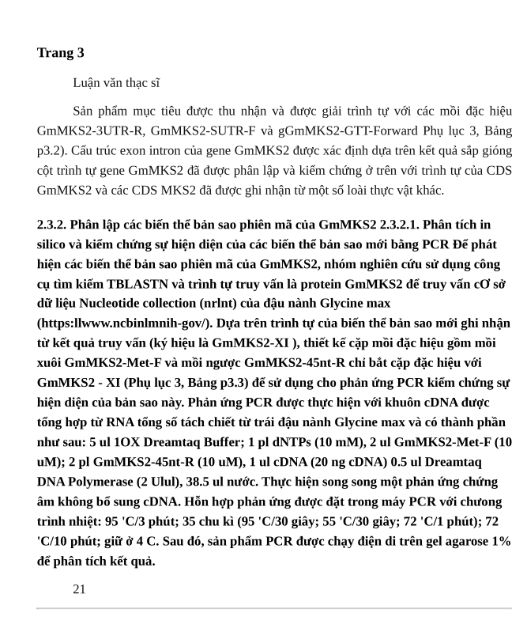

# Google Drive & Web Viewer PDF / Slide Extractor & Academic OCR Engine

Công cụ tự động hóa toàn diện từ việc trích xuất slide / tài liệu PDF từ các trình xem web bảo vệ (đặc biệt là Google Drive Viewer bị chặn tải/in ấn) với độ phân giải siêu cao (HiDPI 2x/3x), cho đến chu trình **OCR Hybrid 5 lớp** nhận diện văn bản học thuật và đóng gói tái tạo lại văn bản chuẩn định dạng luận văn A4.

---

## 📸 Kết Quả Thực Tế Dự Án (Before & After)

Dự án giải quyết triệt để bài toán trích xuất các tài liệu scan phức tạp, chứa thuật ngữ sinh học / y khoa, mã gen, ký hiệu nhiệt độ và liên kết URL:

| Ảnh gốc trích xuất từ Viewer (Input) | Kết quả OCR & Tái tạo trang PDF A4 (Output) |
| :---: | :---: |
|  |  |
| *Tài liệu scan luận văn học thuật gốc* | *Tự động OCR, sửa lỗi danh pháp khoa học & xuất PDF chuẩn* |

---

## 🌟 Tính Năng Nổi Bật

### 1. Trích xuất tài liệu Web / Google Drive Viewer
- **Trích xuất ảnh gốc qua HTML5 Canvas:** Trực tiếp trích xuất bitmap gốc (`naturalWidth`, `naturalHeight`) do máy chủ trả về, đạt độ sắc nét 100%, không dính thanh cuộn (scrollbar) hay viền giao diện.
- **Cơ chế Fallback an toàn:** Tự động fallback sang chụp ảnh element nếu Canvas bị tainted bởi chính sách CORS.
- **Giải quyết triệt để Lazy-Loading:** Thuật toán cuộn mồi (preload) tự động qua toàn bộ trang tài liệu để kích hoạt tải trước khi chụp.
- **HiDPI Render 2x/3x:** Ép trình duyệt render với `--force-device-scale-factor=2` cho mật độ điểm ảnh sắc nét tối đa.
- **Giao diện 1 nút bấm (PyQt6 GUI):** Tích hợp quy trình 1 click: Tải tài liệu -> OCR -> Tái tạo PDF hoàn chỉnh.

### 2. 🔬 Quy Trình OCR Hybrid 5 Lớp Chuyên Sâu (Tiếng Việt & Ký Hiệu Khoa Học)
- **Layer 0 - LLM Difficulty Filter (Offline Qwen2.5-0.5B):** Phân loại thông minh: câu chữ tiếng Việt/tiếng Anh phổ thông được giữ nguyên vẹn tuyệt đối. Chỉ những cụm từ dị thường/siêu khó (mã gen, plasmid, công thức, ký tự dễ nhầm lẫn `1`, `/`, `I`, `l`) mới được đưa vào bộ xử lý sâu.
- **Layer 1 - Visual Hypothesis Permutations:** Sinh các giả thuyết hoán vị cho ký tự khó (`1`, `/`, `I`, `l`, `|`) và so khớp trực quan bằng font Unicode chuẩn (**DejaVu Sans / Arial Unicode MS**) kèm padding 3px.
- **Layer 2 - Initial Baseline Lock:** Cơ chế bảo toàn nguyên bản nếu độ tin cậy ban đầu của từ gốc cao hơn hoặc bằng các hoán vị sau, chống tình trạng sửa nhầm (over-correction).
- **Layer 3 - Deep Academic Context:** Nhận dạng chính xác danh pháp gen, vector plasmid (`pJET1.2`, `pETDuet-1`, `slGmMKS2-X1`, `X1/X2/X3`).
- **Layer 4 - Đơn vị đo & Ký hiệu khoa học:** Tự động chuẩn hóa các đơn vị y sinh: `µg/µl`, `U/µl`, `°C`, đầu mút DNA `3'`, `5'`.
- **Layer 5 - Universal URL Restorer:** Tự động phục hồi toàn diện các liên kết web bị OCR nhận nhầm dấu (ví dụ `//` bị thành `ll` và mất dấu `.`).

### 3. 📄 Tái Tạo PDF Định Dạng Luận Văn Chuẩn A4
- Chuyển đổi Markdown sau OCR thành PDF chỉn chu:
  - Font chữ: **Times New Roman** / **Liberation Serif 13pt**.
  - Căn đều hai lề (Justified), thụt đầu dòng chuẩn 1.25cm, giãn dòng 1.5 lines.
  - Căn lề chuẩn văn bản: Trên 25mm, Dưới 20mm, Trái 25mm, Phải 20mm.

---

## 🚀 Cài Đặt & Khởi Chạy Nhanh

Script `./run.sh` đã tích hợp tự động kiểm tra virtualenv `.venv` và cài đặt đầy đủ dependencies:

```bash
# Cách 1: Khởi chạy Giao diện đồ họa (PyQt6 GUI)
./run.sh --gui

# Cách 2: Mở Menu tương tác Terminal
./run.sh

# Cách 3: Chạy tự động dòng lệnh tải PDF và OCR ra Markdown
./run.sh "<GOOGLE_DRIVE_VIEWER_URL>" -o my_slides.pdf --ocr
```

---

## 🛠️ Tùy Chọn Dòng Lệnh (CLI Options)

| Tham số | Mặc định | Mô tả |
| :--- | :--- | :--- |
| `url` | *(bắt buộc)* | Đường link Google Drive Viewer hoặc Web Viewer |
| `-o`, `--output` | `output.pdf` | Đường dẫn file PDF kết quả sau khi trích xuất |
| `--scale` | `2` | Tỉ lệ scale điểm ảnh HiDPI (2x, 3x) |
| `--selector` | `div.ndfHFb-c4YZDc-cYSp0e-DARUcf-PLDbbf` | CSS selector của container trang tài liệu |
| `--no-headless` | `False` | Hiển thị cửa sổ Chrome trực quan khi chạy |
| `--settle` | `1.0` | Thời gian chờ (giây) để ảnh giải mã sau khi cuộn tới |
| `--timeout` | `30.0` | Thời gian tối đa (giây) chờ DOM trang nạp |
| `--user-data-dir` | `None` | Đường dẫn profile Chrome (dành cho tài liệu yêu cầu đăng nhập) |
| `--keep-temp` | `False` | Giữ lại các ảnh PNG từng trang trong thư mục `.temp_pages` |
| `--ocr` | `False` | Bật tính năng OCR từng trang sau khi trích xuất xong PDF |
| `--ocr-output` | `None` | Thư mục lưu kết quả OCR Markdown |

### Ví dụ thao tác nâng cao:

1. **Trích xuất tài liệu bảo vệ (Headless):**
   ```bash
   ./run.sh "https://drive.google.com/file/d/xxxx/view" -o document.pdf
   ```

2. **Chạy tài liệu cần đăng nhập Google Account:**
   ```bash
   ./run.sh "https://drive.google.com/file/d/xxxx/view" --user-data-dir ~/.config/google-chrome/Default -o private_document.pdf
   ```

3. **Trích xuất và tự động OCR:**
   ```bash
   ./run.sh "https://drive.google.com/file/d/xxxx/view" -o doc.pdf --ocr --ocr-output ketqua/
   ```

---

## 🧪 Kiểm Thử Hệ Thống (Unit Test)

Chạy bộ kiểm thử tự động để kiểm tra logic xử lý PDF và trích xuất:

```bash
source .venv/bin/activate
python3 -m unittest discover test
```
